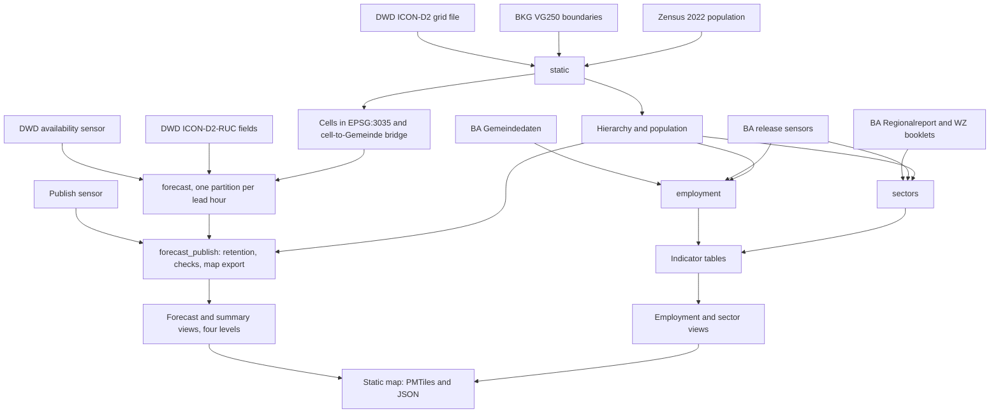

# Architecture

datlas serves measurements from official sources on the administrative
hierarchy of Germany and shows them on a static map. It grew out of the Berlin
capstone *24h temperature forecast for Berlin neighborhoods* (`ohexel/lwr`) and
keeps its architecture: `raw` → `normalized` → `analytical` layers, versioned
area-weighted spatial bridges, pinned source contracts and asset checks as
quality gates. Since v3.0 it runs on its own ([ADR 021](adr/021-separation-from-the-capstone.md)).

## Problem and serving grain

Analysts who compare regions in Germany need values on the official
administrative hierarchy: Bund → 16 Länder → 400 Kreise → 10,990 Gemeinden.
datlas serves measurements at the levels the sources publish, with an explicit
status wherever a value is suppressed or not reported. It does not classify
values or set thresholds (ADR 007).

| Theme | Serving grain |
| --- | --- |
| Temperature forecast | One region (Gemeinde, Kreis, Land or Bund) and one lead hour 0–24 of the current complete run; one summary row per region with the 24-hour maximum and minimum. |
| Employment | One region and level for the newest BA reference date (yearly). |
| Sectors | One Kreis, Land or Germany for the newest quarter. |

## System overview

Python owns source-specific acquisition, GRIB/NetCDF and workbook decoding,
and operational coordination. PostgreSQL/PostGIS owns durable relational
state, spatial intersections, constraints, set-based transformations,
roll-ups and serving views. Dagster owns asset lineage, partition execution,
quality checks, run history, and source-aware triggering (ADR 001). Docker
runs PostgreSQL/PostGIS and, optionally, Dagster; the application uses a
reproducible `uv` environment.

This is a source-aware **batch pipeline**: hourly forecast partitions, yearly
and quarterly BA vintages. It is not a streaming platform, an operated
service, or a decision system.

## Sources

| Source | Grain | Refresh behavior | Operational role |
| --- | --- | --- | --- |
| DWD ICON-D2 grid (`icon_grid_0047_R19B07_L`) | 542,040 triangular cells | Static; downloaded once when missing | Cell geometry of the forecast fields. |
| DWD ICON-D2-RUC | Forecast run, lead time, grid cell | Hourly runs, kept by DWD for about 24 hours | Temperature, humidity and wind fields. |
| BKG VG250 | Staat, Länder, Kreise, Gemeinden; status 31 Dec 2022, EPSG:25832 | Static (one vintage, checksum pinned) | Administrative hierarchy and geometry. |
| Zensus 2022 table 1000A-1003 | Länder, Kreise, Gemeinden; reference date 15 May 2022 | Static (one census, checksum pinned) | Total population per region and the published totals for the source checks. |
| BA Gemeindedaten (product 229) | Germany, Länder, Kreise, Gemeinden; reference date 30 June | Yearly (January); structure contract for every vintage, checksum pinned for the known one | Employees by place of residence and of work, commuters, establishments. |
| BA Regionalreport über Beschäftigte (product 709) | Kreise; quarterly, five quarters per file | Quarterly (about six months after the quarter); structure contract | WZ sections and three manufacturing groups. |
| BA Beschäftigte nach Wirtschaftszweigen | Länder and Germany; quarterly | Quarterly; structure contract | Every WZ division (motor vehicles, mechanical engineering, chemicals, steel). |

Source contracts, licences and attribution: [data-sources.md](data-sources.md).

## Schema

All DDL is in `sql/` and idempotent. `base_schema.sql` creates the schemas,
PostGIS, the grid tables and the shared functions; every job applies it before
the other files (`raw_schema.sql` → `normalized_schema.sql` →
`forecast_schema.sql`, `indicator_schema.sql` → `sector_schema.sql`), so a run
on an empty database builds what it needs and no separate install step
exists. A test builds the whole schema twice on an empty database and compares
the objects with those the files declare.

| Schema | Relations |
| --- | --- |
| `raw` | `icon_grid_source`, `icon_grid_vertex`, `icon_grid_cell_vertex`, `vg250`, `zensus2022_population`, `ba_gemeindedaten`, `ba_regionalreport`, `ba_wz_heft` |
| `normalized` | `icon_cell` (every grid cell in EPSG:3035), `icon_geometry_rejected`; `land`, `kreis`, `gemeinde` (hierarchy, EPSG:3035 geometry, area), `gemeinde_population`, `zensus_published_population`; `icon_cell_gemeinde_bridge`, `forecast_run`, `icon_cell_value`, `gemeinde_forecast`; `indicator_source`, `indicator`, `indicator_value` (theme-independent indicators, ADR 019), `indicator_sum_component` (declared sums), `indicator_quality_note` (reviewed source discrepancies) |
| `analytical` | `current_run`; `current_{gemeinde,kreis,land,bund}_forecast_25h`; `current_{gemeinde,kreis,land,bund}_summary`; `current_employment`; `current_sectors` |

## Forecast path

A forecast partition is a UTC model run and a lead time (ADR 003). For each
lead hour, the four GRIB fields (temperature, relative humidity, wind U and V)
are decoded and validated over the whole grid; the values of the cells in the
bridge are staged in PostgreSQL, which converts units, computes shade apparent
temperature, stores temperature and apparent temperature per cell for the two
retained runs (`icon_cell_value`, ADR 018) and aggregates cells to Gemeinden by
the fraction of each Gemeinde's area that a cell covers
(`refresh_forecast_partition`), computed in the equal-area projection
EPSG:3035 (ADR 014).

Kreis, Land and Bund values are rolled up from Gemeinden with an area and a
population weighting (ADR 015). The `_summary` views hold the 24-hour maximum
and minimum of each measure and its time, with one rule for all four levels
(highest or lowest value, earliest time on a tie). The `current_*` views show
the newest run in which every Gemeinde has all 25 lead times. Gemeinden
without a census record contribute no population weight; missing population
is never treated as zero.

## Indicator model

Employment and sector values share one theme-independent model (ADR 019):
catalogue rows (`indicator_source`, `indicator`), and one row per geography
version, level, region, indicator and reference date in `indicator_value`,
with `value_status` = `value`, `suppressed` or `not_reported` (and a reason).
The serving views read the BA's own published Kreis, Land and Germany values
rather than sums of suppressed Gemeinden; derived values (the jobs ratio,
sector shares, Land sums of groups) are marked as own calculations. The
sector theme uses the same tables for two sources at the levels they publish
(ADR 020).

## Orchestration

One Dagster code location (`src.dagster_pipeline.definitions`) with four asset
groups, one per theme, each run by its jobs:

| Job | Started by | What it does |
| --- | --- | --- |
| `static` | `python -m src.run_static` | ICON grid (downloaded when missing) and its cells, VG250 and Zensus raw loads, hierarchy, population, bridge; the grid check, two source contracts and checks 1–4. Safe to repeat. |
| `forecast` | `dwd_forecast_availability_sensor`, or `python -m src.run_forecast --run-time …` | One partition per run and lead time: the four raw DWD fields (files only) and the aggregation in SQL. Runs in process. |
| `forecast_publish` | `forecast_publish_sensor`, or `run_forecast` after its partitions | Publishes the newest complete run: retention of rows and GRIB files, checks 5–6, map export (asset `web/germany_dashboard`). Runs in process. |
| `employment` | `ba_gemeindedaten_release_sensor`, or `python -m src.run_employment [--reference-date …]` | Downloads one BA vintage, loads it raw, refreshes the indicator values and runs checks 8–11. |
| `sectors` | `ba_sectors_release_sensor`, or `python -m src.run_sectors [--file-date …]` | Downloads one quarter of both sector products (434 files, one request at a time with a 3 s pause; on HTTP 429 it waits minutes, then records a cool-down that every download and the sensor respect, and stops so the next run resumes), loads them raw, refreshes the sector values and runs checks 12–15. |

All four sensors start stopped and are switched on in the Dagster UI. The
availability sensor checks DWD every five minutes in the second half of each
hour and starts at most ten new partitions per check, newest runs and lead
times first; a partition gets at most five attempts. The publish sensor checks
the database every minute and publishes each newest complete run once.
`docker/dagster.yaml` allows two runs at a time and stops a run after 300 s;
`static`, `employment` and `sectors` carry the tag `dagster/max_runtime: 1800`.

## Checks

Seventeen asset checks compare the data with their sources and with
themselves: the grid file and its cells; the raw VG250 and Zensus files
against their checksums and counts; key coverage and hierarchy integrity on
the hierarchy, source totals on the population, bridge coverage on the bridge,
and completeness and plausibility on the published forecast; four on the BA
Gemeindedaten (structure, identities between columns, keys against the
hierarchy, Gemeinde, Kreis and Land values against the BA's own totals); and
four on the sector data (structure, identities within each Kreis, totals across
Kreise, Länder, both products and the Gemeindedaten, coverage). Rules and
thresholds: [pipeline.md](pipeline.md#checks-and-thresholds).

## Map

The publish job writes a static folder, `web/germany-dashboard/`: a PMTiles
archive of Land, Kreis and Gemeinde outlines (built once per geography
version), one `values.json` per run, one `employment.json` per BA vintage and
one `sectors.json` per quarter, joined in the browser by regional key
(ADR 016). The page is in German and has three themes: industry (share of
metal, electrical and steel per Kreis and Land, 0 to 40 %; the page opens with
it), employment (jobs at place of work per employed resident on a fixed
logarithmic scale) and temperature (24-hour maxima or minima on a fixed scale
from -20 to +30 °C, legend limited to the displayed range). The host must
answer HTTP Range requests; the local preview (`src/preview_server.py`) does.
There is no database connection from the page and no basemap or API key.
Copying the folder to the web host is outside the pipeline.

## Retention

The database keeps the newest complete run, the complete run before it, and a
newer run while it is loading (ADR 018). GRIB files are kept while their run
is in the database or younger than the rolling window of at most 24 hours
(ADR 021). Both are applied by the publish job. The Dagster forecast
partitions cover the same window, so DWD runs older than 24 hours are not
offered for processing.

## Adding a further theme

A theme that publishes values per region uses the indicator tables (ADR 019):
catalogue rows in `indicator_source` and `indicator`, a raw table as delivered,
a refresh function that writes `indicator_value` with an explicit status for
every region, a serving view, a source contract and checks against the
source's own published totals, and its own asset group and job. The hierarchy
and the indicator tables do not change. A theme that is computed from a grid,
like the forecast, keeps its own tables and roll-ups.

## Failure boundaries and restart behavior

- `static` can run again: the same VG250 file leaves the geography version
  unchanged, a different file is refused; population and the bridge are
  rebuilt.
- The forecast views switch only to a run in which every Gemeinde has all 25
  lead hours; a newer incomplete run never displaces the previous complete
  one (check 5 warns about it). A partition whose model field has missing
  values is refused instead of averaging over fewer cells.
- A GRIB file that fails to decode or validate leaves a note under
  `data/raw/quarantine/icon_d2_ruc/` and fails its partition; the sensor
  retries it up to five attempts in total.
- Every BA file is checked against its structural contract; a changed layout
  stops the load rather than being guessed. In the sector theme each file is
  checked before it is kept, and one bad file stops the run.
- `run_sectors` resumes from the files on disk after the BA throttles, and a
  shared cool-down file keeps every client and the sensor from sending
  requests until it has passed.
- Dagster asset checks prevent incomplete or inconsistent loads from being
  reported as successful.

Decisions are recorded in the [ADRs](adr/README.md); operation and
measurements are in [pipeline.md](pipeline.md) and [facts.md](facts.md).
